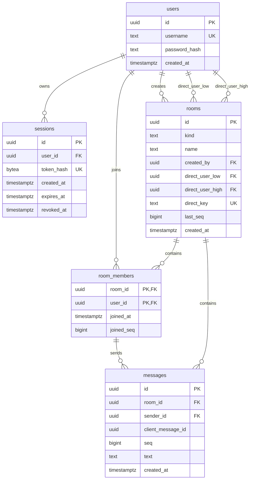

# Initial PostgreSQL schema

`migrations/001_initial.sql` defines the T1 tables. IDs are supplied by the application. Its caller owns the transaction; the migration contains no `BEGIN` or `COMMIT` and intentionally fails if an existing definition conflicts. T2 will add migration version tracking and Go database setup.



The message sender's `(room_id, sender_id)` must match a membership. `direct_key` is generated from the sorted UUID pair and is unique. PostgreSQL unique constraints allow multiple null group keys. Foreign keys use restricted deletion because account and room deletion are out of scope.

## Run the acceptance check

Use an isolated PostgreSQL 18 database and run from the `apps/api/internal/store` directory:

```sh
psql -X -v ON_ERROR_STOP=1 -d "$TEST_DATABASE_URL" -f tests/schema.sql
```

The script creates a test schema inside one transaction, applies the migration through a relative `psql` include, tests fixtures and constraint failures, prints the server version and result, then rolls back the schema and all fixtures. It does not touch the application's tables. A failed check exits nonzero. To apply the migration manually to a fresh database, use `psql -X -v ON_ERROR_STOP=1 --single-transaction -d "$DATABASE_URL" -f migrations/001_initial.sql`. The application migration runner in T2 will own this step.

## Rules owned by services

Table checks cannot enforce cross-row or access rules. Services must atomically create a room with its initial memberships: exactly its two designated users for a direct room, or only the creator for a new group. A group join must be initiated by the authenticated user; callers cannot add another user. The session supplies identity for all room and message operations, and passwords must be hashed with the chosen Argon2id format before insertion.

To send, lock the room row, verify membership, handle `(sender_id, client_message_id)` retries, increment `last_seq`, and insert the message in one transaction. A failed insert must roll back the counter. Group join also locks the room row and records its current `last_seq` as `joined_seq`; group history returns only messages with `seq > joined_seq`. Direct-room members start at zero. The database range checks keep sequences within JavaScript's safe integer range, but these service transactions establish the join and history boundary.
